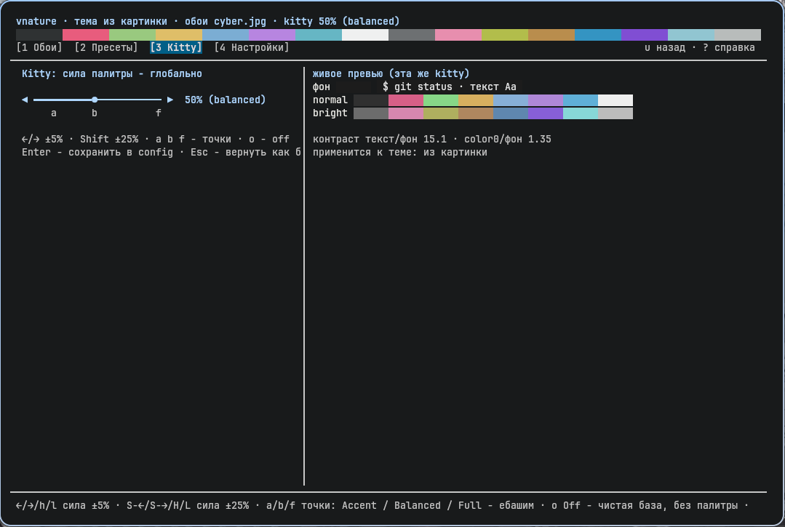
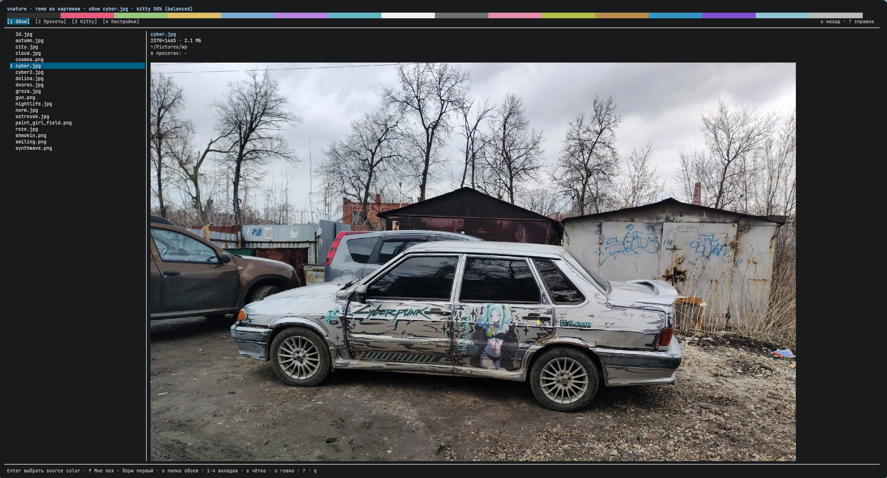
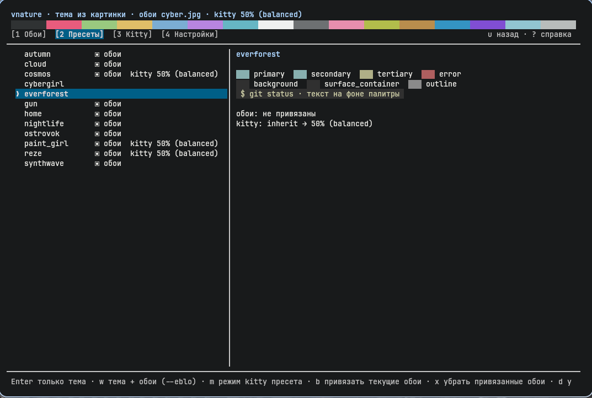

# vnature

vnature - переключатель тем для Linux-десктопа с интерфейсом в терминале. Вы выбираете обои,
[matugen](https://github.com/InioX/matugen) строит по ним палитру Material You, а vnature раскладывает
её по конфигам kitty, Hyprland, waybar, swaync, rofi, polybar и Obsidian, ставит обои и перезагружает
то, что умеет перезагружаться. От голого конфига matugen его отличает следующее:

- TUI с вкладками и превью: картинка обоев прямо в терминале (в kitty), палитра пресета, образец текста;
- пресеты: удачная палитра сохраняется под именем, к ней можно привязать обои и режим kitty;
- kitty перекрашивается бережно: ANSI-цвета сохраняют свои оттенки (красный остаётся красным),
  от палитры берутся яркость и насыщенность, контраст текста проверяется и подтягивается;
- ползунок силы kitty 0-100%: от почти нейтральной темы до полной палитры, с живым применением;
- откат: `vnature undo` возвращает предыдущую тему, повторный вызов - обратно;
- `--dry-run`: всё рендерится и проверяется, но ничего не записывается.







## Требования

Обязательно:

- Linux;
- Python >= 3.11 (нужен `tomllib`), только стандартная библиотека, внешних зависимостей нет;
- [matugen](https://github.com/InioX/matugen) - палитра из картинки.

Обои:

- в Hyprland - через hyprpaper (`hyprctl` и `hyprpaper` должны быть установлены,
  hyprpaper запускается сам, если ещё не работает);
- вне Hyprland - через `feh --bg-fill`, то есть только в X11.

Остальные приложения опциональны. Если у приложения нет папки конфига (например, `~/.config/waybar`),
vnature пишет "нет ..., пропускаю" и идёт дальше. Перезагрузка тоже пропускается, если нет нужной команды.

## Установка

Из клона, без установки:

```sh
git clone https://github.com/sl33pwalk/vnature ~/src/vnature
~/src/vnature/vnature --version
ln -s ~/src/vnature/vnature ~/.local/bin/vnature   # по желанию, симлинк работает
```

Через [pipx](https://pipx.pypa.io/):

```sh
pipx install ~/src/vnature
vnature --version
```

Тесты: `python3 -m unittest discover -s tests` в корне клона.

## Подключение приложений

vnature пишет только свои файлы. Основные конфиги нужно один раз настроить на их подключение.
Ниже `USER` - ваше имя пользователя.

### kitty

vnature пишет `~/.config/kitty/vnature.conf`. В конце `~/.config/kitty/kitty.conf`:

```conf
include vnature.conf
```

Если раньше тема ставилась через `kitten themes`, уберите из `kitty.conf` его блок, иначе он будет
спорить с vnature:

```conf
# BEGIN_KITTY_THEME
# ...
include current-theme.conf
# END_KITTY_THEME
```

Перезагрузка: kitty сам замечает изменение файла (`auto_reload_config`, включено по умолчанию).
Окнам kitty без такого наблюдателя vnature отправляет `SIGUSR1`, по которому kitty перечитывает конфиг.

### Hyprland

Нужен Lua-конфиг (`hyprland.lua`). vnature пишет `~/.config/hypr/vnature.lua` (цвета рамок окон)
и вызывает `hyprctl reload`. В `~/.config/hypr/hyprland.lua`:

```lua
pcall(require, "vnature")
```

### waybar

vnature пишет `~/.config/waybar/vnature.css`. Первой строкой в `~/.config/waybar/style.css`:

```css
@import "vnature.css";
```

Сам vnature waybar не перезагружает, поэтому включите автоперезагрузку стилей в `~/.config/waybar/config.jsonc`:

```jsonc
"reload_style_on_change": true,
```

Файл задаёт цвета `@vn_bg`, `@vn_fg`, `@vn_muted`, `@vn_primary`, `@vn_primary_container`,
`@vn_outline`, `@vn_error`, их можно использовать в своих стилях.

### swaync

vnature пишет `~/.config/swaync/vnature.css` и вызывает `swaync-client --reload-css`.
Первой строкой в `~/.config/swaync/style.css`:

```css
@import "vnature.css";
```

### rofi

vnature пишет `~/.cache/vnature/generated/rofi.rasi`. Первой строкой в `~/.config/rofi/config.rasi`:

```css
@import "/home/USER/.cache/vnature/generated/rofi.rasi"
```

### polybar

vnature пишет `~/.cache/vnature/generated/polybar.ini`. В конфиге polybar:

```ini
include-file = /home/USER/.cache/vnature/generated/polybar.ini
```

Цвета доступны как `${colors.background}`, `${colors.primary}` и так далее
(список - в `vnature_pkg/templates/polybar.ini`). Перезапуск: vnature запускает
`~/.config/polybar/launch.sh`, если он есть, и только в X11-сессии.

### Obsidian

vnature находит хранилища из `~/.config/obsidian/obsidian.json` (и Flatpak-варианта в
`~/.var/app/md.obsidian.Obsidian/config/obsidian/obsidian.json`) и кладёт сниппет в
`<vault>/.obsidian/snippets/vnature.css`. Если там уже был свой `vnature.css`, он один раз
сохраняется как `vnature.css.before-vnature`. Включите сниппет: Settings, Appearance, CSS snippets, vnature.

### Обои после перезапуска (опционально)

hyprpaper меняет обои на лету, но при следующем входе прочитает свой `hyprpaper.conf`.
Если есть исполняемый `~/.local/bin/hyprpaper-save-current`, vnature вызывает его после смены обоев:
это ваш скрипт, который записывает текущие обои в `hyprpaper.conf`. Если его нет, шаг пропускается.

## Команды

Без команды открывается TUI. Глобальные флаги работают и до, и после команды:
`--dry-run` (всё проверить, ничего не менять), `--wallpaper-dir DIR` (папка обоев вместо
`wallpaper_dir` из `config.toml`), `--version`, `-h`/`--help`.

| Команда | Алиас | Что делает |
|---|---|---|
| `vnature apply PRESET [--eblo]` | `vnature PRESET` | применить пресет; с `--eblo` (или `--wallpaper`) вместе с его обоями |
| `vnature image PATH [--first-color]` | `vnature PATH` | палитра из картинки; matugen спросит source color, с `--first-color` берётся первый |
| `vnature save NAME [--eblo]` | `chotko` | сохранить текущую тему как пресет; с `--eblo` привязать к нему текущие обои |
| `vnature undo` | `govno` | вернуть предыдущую тему, повторный вызов - обратно |
| `vnature list` | `kto` | список пресетов |
| `vnature status` | `cho` | что применено сейчас |
| `vnature delete NAME` | `nahui` | удалить пресет (с подтверждением) |
| `vnature migrate` | | скопировать пресеты из старого места (см. ниже) |

Старые формы тоже работают: `vnature --eblo PRESET` = `apply PRESET --eblo`,
`vnature --poh PATH` = `image PATH --first-color`.

```sh
vnature --dry-run apply autumn --eblo   # что было бы записано
vnature image ~/Pictures/wp/forest.jpg  # новая тема из картинки
vnature save forest --eblo              # сохранить её вместе с обоями
vnature undo                            # не понравилось
```

## TUI

Четыре вкладки: Обои, Пресеты, Kitty, Настройки. От 80 колонок экран делится на список и превью,
на узком окне остаётся одна колонка. Превью картинки работает только в настоящем kitty
(через `kitten icat`), в tmux и других терминалах показывается текстовое превью.
Справка по клавишам - `?`.

Везде:

| Клавиши | Действие |
|---|---|
| `1` `2` `3` `4`, `Tab`, `Shift+Tab` | вкладки |
| `↑` `↓`, `j` `k`, `PgUp` `PgDn` | выбор |
| `s` | сохранить текущую тему как пресет |
| `u` | вернуть предыдущую тему |
| `?` | справка |
| `q` | выход |

Обои: `Enter` - палитра из картинки с выбором source color, `f` - взять первый source color,
`o` - сменить папку обоев.

Пресеты: `Enter` - применить только тему, `w` - тему и обои, `m` - режим kitty этого пресета,
`b` - привязать текущие обои, `x` - отвязать обои, `d` - удалить.

Kitty (и окно `m` для пресета):

| Клавиши | Действие |
|---|---|
| `←` `→`, `h` `l` | сила -5% / +5% |
| `Shift+←` `Shift+→`, `H` `L` | сила -25% / +25% |
| `a` `b` `f` | точки accent / balanced / full |
| `o` | off: чистая база без палитры |
| `i` | только для пресета: наследовать глобальное значение |
| `Enter` | сохранить (в `config.toml` или в пресет) |
| `Esc` | вернуть как было |

kitty перерисовывается через 200 мс после последнего нажатия, поэтому при быстром листании
перерисовка одна. Если уйти с вкладки, не нажав `Enter`, значение откатывается.

Настройки: `Enter` - изменить выбранный пункт.

## Сила kitty

`kitty_mode` задаёт, насколько тема kitty уходит от базы к палитре:

| Значение | Что получится |
|---|---|
| `accent` (15) | минимум изменений: фон, текст и ANSI почти как в базе, из палитры курсор, выделение, ссылки, вкладки и рамки |
| `balanced` (50) | фон и текст заметно окрашены, ANSI подстроены |
| `full` (100) | палитра целиком |
| `off` | чистая база (`kitty_base` или встроенная), палитра не подмешивается |
| число 0-100 | любая точка между ними |

В пресете ещё есть `inherit`: взять значение из `config.toml`. Во всех режимах, кроме `off`, цветные ANSI
сохраняют оттенок базы (от палитры берутся яркость и насыщенность), а контраст текста с фоном
не опускается ниже 4.5:1.

## Настройки: config.toml

`~/.config/vnature/config.toml` создаётся при первом запуске:

```toml
wallpaper_dir = "~/Pictures/wp"   # откуда TUI берёт список обоев
mode = "dark"                     # режим matugen: dark или light
kitty_mode = "accent"             # accent, balanced, full, off или число 0-100
# kitty_base = "base.conf"        # своя база для kitty, путь от ~/.config/vnature или абсолютный
```

`kitty_base` - файл в формате kitty.conf. Из него берутся строки `background`, `foreground`,
`inactive_tab_background`, `inactive_tab_foreground` и `color0`...`color15` в виде `#rrggbb`,
остальное игнорируется. Без `kitty_base` используется встроенная нейтральная база.

## Где что лежит

| Путь | Что там |
|---|---|
| `$XDG_DATA_HOME/vnature/presets/` (по умолчанию `~/.local/share/vnature/presets/`) | пресеты |
| `~/.config/vnature/config.toml` | настройки |
| `~/.local/state/vnature/current`, `previous` | текущая и предыдущая тема |
| `~/.cache/vnature/generated/` | `rofi.rasi`, `polybar.ini`, `obsidian.css` |

Пресет - папка с `palette.conf` и необязательным `preset.toml`:

```toml
wallpaper = "autumn.jpg"   # относительно wallpaper_dir или абсолютный путь
kitty_mode = "inherit"     # inherit, accent, balanced, full, off или число 0-100
```

Раньше пресеты лежали в `presets/` рядом со скриптом. Если там что-то есть, а в новом месте пусто,
vnature подскажет об этом (в TUI спросит при запуске). `vnature migrate` копирует пресеты в новое место:
уже существующие не перезаписываются, старые не удаляются. Удалите их сами, когда убедитесь,
что всё на месте. `vnature --dry-run migrate` покажет, что будет скопировано.

## Что перезаписывается

- `~/.config/kitty/vnature.conf`, `~/.config/hypr/vnature.lua`, `~/.config/waybar/vnature.css`,
  `~/.config/swaync/vnature.css` и файлы в `~/.cache/vnature/generated/` - без резервных копий, это файлы vnature.
- `<vault>/.obsidian/snippets/vnature.css` во всех найденных хранилищах Obsidian (первый чужой файл сохраняется, см. выше).

`vnature undo` возвращает предыдущую тему vnature (один шаг), но не состояние конфигов до vnature.

## Ограничения

- Обои ставятся только в Hyprland (hyprpaper) или в X11 (feh). Других Wayland-композиторов нет.
- Hyprland поддерживается только с Lua-конфигом.
- Набор приложений фиксированный: kitty, Hyprland, waybar, swaync, rofi, polybar, Obsidian.
  Шаблоны лежат в `vnature_pkg/templates/`, новое приложение без правки кода не добавить.
- waybar vnature не перезагружает, нужен `reload_style_on_change`.

## Лицензия

MIT, см. [LICENSE](LICENSE).
